<div align="center">

# Crear Vídeos Pro

**Copia el estilo de edición de cualquier reel y edita tus vídeos con él, con Claude Code y HyperFrames.**


Un plugin de Claude Code con 5 skills de edición, el Estilo Maestria, 6 estilos de otros creadores y todo el stock del equipo. Transcribe en tu ordenador, sin gastar créditos.

<table>
  <tr>
    <th>📥 El reel de referencia</th>
    <th>✨ El reel hecho con este repo</th>
  </tr>
  <tr>
    <td>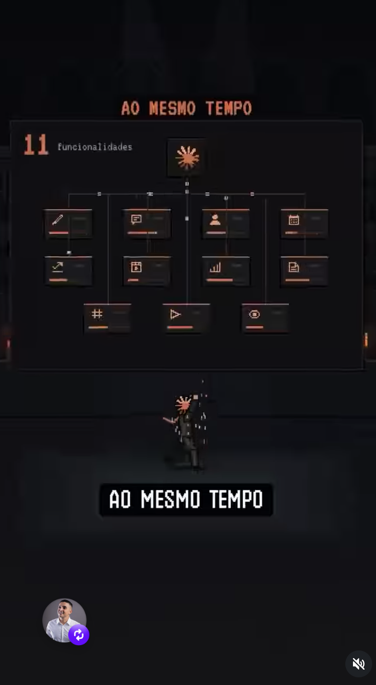</td>
    <td>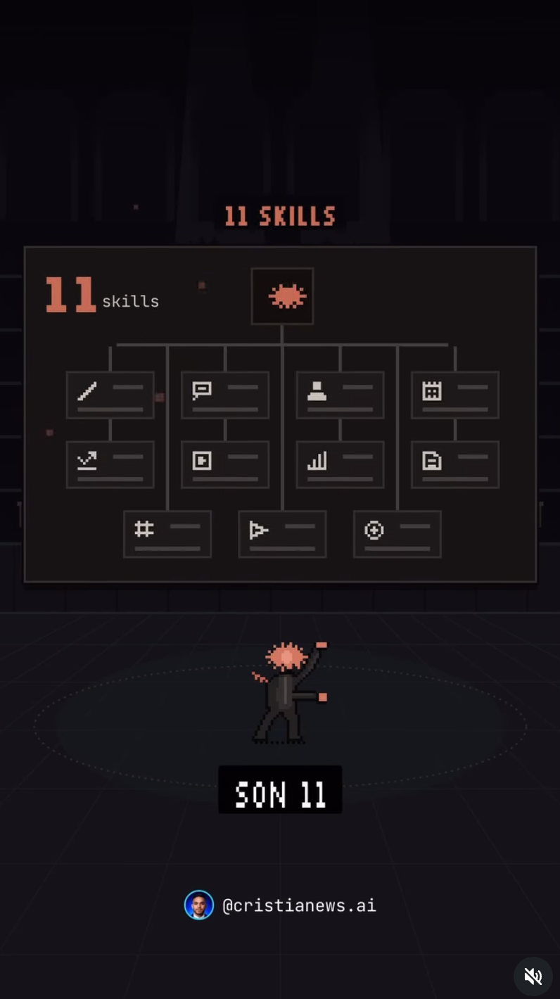</td>
  </tr>
  <tr>
    <td align="center"><sub>Original de Viral2, en portugués </sub></td>
    <td align="center"><sub>Mismo estilo, otro tema: «K.O.»</sub></td>
  </tr>
</table>

</div>

---

## 📈 Resultados reales

El reel «K.O.» hecho con este flujo:

| 👁️ Visualizaciones | ❤️ Me gusta | 💬 Comentarios |
|:---:|:---:|:---:|
| **142 mil** | **4.898** | **3.058** |

<table>
  <tr>
    <td width="40%">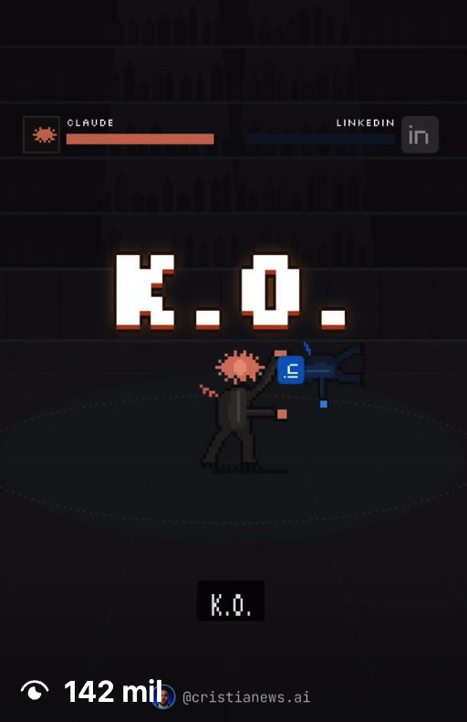</td>
    <td>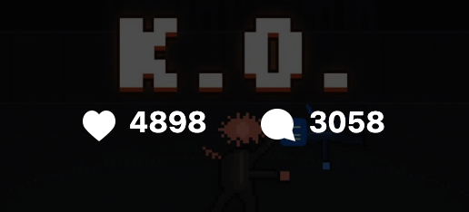<br><br>
    <br>
    </td>
  </tr>
</table>

Las cuentas que lo usan: **cristianews.ai** (31 mil seguidores) y **josenews.ai** (9.595 seguidores).

## 🎞️ Galería

Motions hechos con este repo:

| | | | |
|:---:|:---:|:---:|:---:|
| 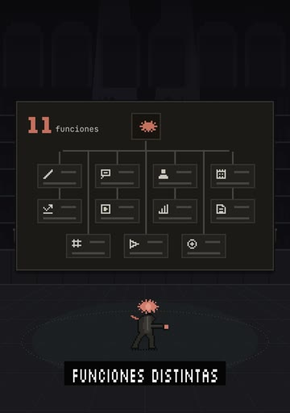 | 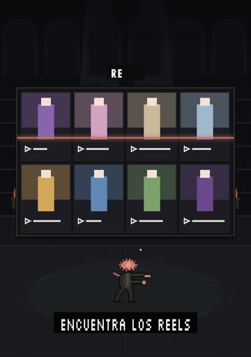 | 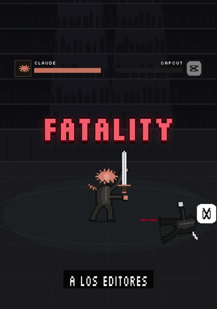 | 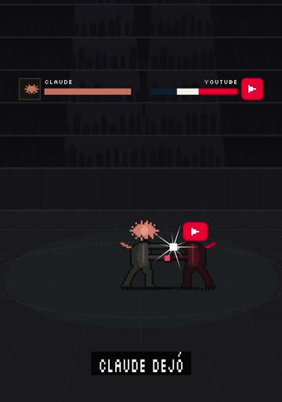 |
| 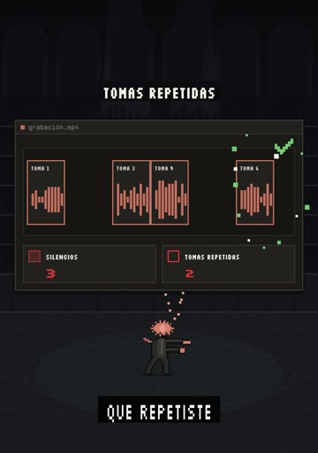 | 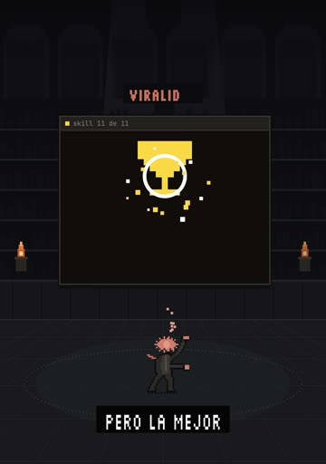 | 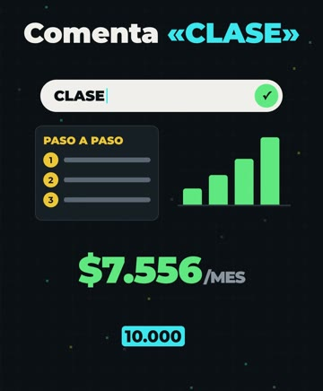 | |

## ▶️ Vídeo de ejemplo

[](https://www.youtube.com/watch?v=UPa0uNzbH1s&t=83s)

<sub>Haz clic en la imagen: se abre en YouTube en el minuto 1:23.</sub>

## Qué hace

| Skill | Qué hace | Cómo se activa |
|---|---|---|
| 🔍 `crear-estilo-videos` | Pasas el link de un reel y saca una ficha (`estilo.md`) con valores medidos: cortes, ritmo, subtítulos, color, sonido y transcripción | «Copia el estilo de este reel» |
| 🎬 `editar-con-estilo` | Edita tu vídeo a cámara con una ficha: corta silencios, subtítulos palabra a palabra, motions con HyperFrames, música y efectos | «Edita mi vídeo con el estilo Maestria» |
| 🔁 `variaciones-video` | 5 versiones de un vídeo con ganchos, encuadres e inicios distintos, más 5 descripciones | «Hazme 5 variaciones para Trial Reels» |
| 📤 `adaptar-para-subir` | Deja imágenes y vídeos listos para subir: JPEG 1080, sin metadatos, con la ubicación | «Adáptalos para subir» |
| 📸 `adaptar-fotos` | Fotos al tamaño original, en Display P3, con datos de cámara y ubicación | «Adapta estas fotos» |

En Claude Code se llaman con el prefijo del plugin: `/crear-videos-pro:crear-estilo-videos`. También basta con pedirlo con tus palabras.

## Cómo funciona

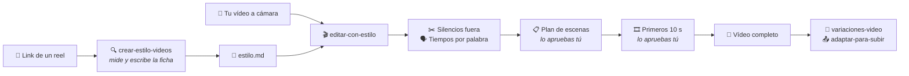

## Cómo encaja todo

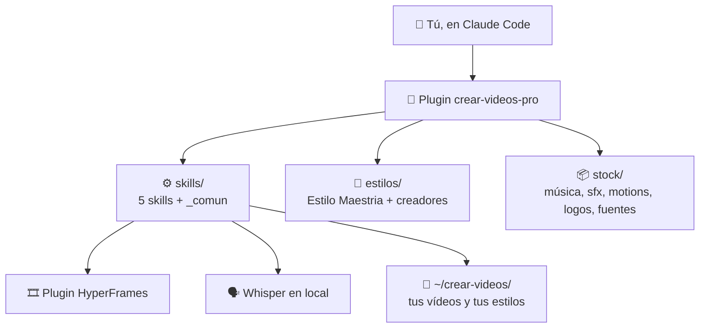

El plugin se sustituye entero al actualizar: **lo tuyo vive fuera**, en `~/crear-videos/` (vídeos y estilos nuevos) y `~/.config/crear-videos/` (ajustes y tu clave).

## Mac y Windows

| | 🍎 Mac | 🪟 Windows 10 / 11 |
|---|---|---|
| **Guía** | [INSTALAR.md](INSTALAR.md#mac) | [INSTALAR.md](INSTALAR.md#windows) |
| **Instalar** | `bash mac/instalar.sh` | `windows\instalar.cmd` |
| **Actualizar** | `bash mac/actualizar.sh` | `windows\actualizar.cmd` |
| **Programas** | Homebrew: ffmpeg, exiftool, yt-dlp, Python, Node, whisper-cpp, gh | winget: ffmpeg (Gyan), ExifTool, yt-dlp, Python 3.13, Node LTS, gh + zip oficial de whisper.cpp |

El plugin solo, dentro de Claude Code (2.1.275 o más), es `/plugin install crear-videos-pro --marketplace eternitydevzz/crear-videos-pro`, pero **sin el instalador las skills no funcionan**: les faltan el Python del equipo, Whisper y el modelo.

**Lo más fácil:** clona el repo, abre Claude Code en la carpeta y dile *«instálame esto»*. Sigue [INSTALAR.md](INSTALAR.md) y te dice lo que tienes que hacer tú (contraseña del Mac, iniciar sesión en GitHub, tu clave).

## Lo que necesitas

| | |
|---|---|
| 🤖 **Claude Code** con un plan de pago | Pro, Max, Team o Enterprise. El plan gratis no incluye Claude Code |
| 🐙 **Acceso al repo** | Es privado: acepta la invitación y conecta GitHub con `gh auth login` |
| 🔑 **Tu clave de [ScrapeCreators](https://scrapecreators.com)** (opcional) | Solo para bajar un reel cuando yt-dlp falla. Cada persona usa la suya |
| 💾 **~1,2 GB libres** | ~640 MB del plugin (Claude Code guarda dos copias) + 488 MB del modelo de Whisper |

## Estructura

```
.claude-plugin/   el plugin y su marketplace
skills/           las 5 skills y _comun/ (código común y comprobar.py)
estilos/          Estilo Maestria/ (4 fichas, 2 motores, herramientas) y creadores/ (6 estilos)
stock/            música, sfx, motions, logos, fuentes, plantillas y vídeos de referencia
mac/  windows/    instalar y actualizar
docs/             flujo.md e imágenes del README
pruebas/          comprobación de enlaces
```

- [INSTALAR.md](INSTALAR.md): instalación paso a paso.
- [STOCK.md](STOCK.md): qué hay en el stock y en los estilos.
- [CLAUDE.md](CLAUDE.md): el manual del repo para Claude.
- [docs/flujo.md](docs/flujo.md): el flujo de trabajo completo.

## Lo que no hace

- No publica en Instagram ni en YouTube.
- No escucha el audio: lo mide. Lo que digas tú de la música y los sonidos manda.
- No sustituye tu ojo: hay que aprobar el plan, los primeros 10 segundos y cada pasada.
- No va rápido en un ordenador de 8 GB: los renders largos se hacen por trozos.
- La música, las fuentes de pago y los logos del stock son para uso interno del equipo.

## Actualizar

```bash
bash mac/actualizar.sh
```

En Windows: `windows\actualizar.cmd`. Después, abre una sesión nueva de Claude Code.

## Versiones probadas

| Pieza | Versión |
|---|---|
| macOS | 26.6.2 |
| Claude Code | 2.1.296 |
| HyperFrames | 0.8.114 |
| ffmpeg | 9.0.2 |
| whisper.cpp | 1.9.4 |
| Python | 3.14.7 · Pillow 13.0.0 · numpy 2.5.4 |
