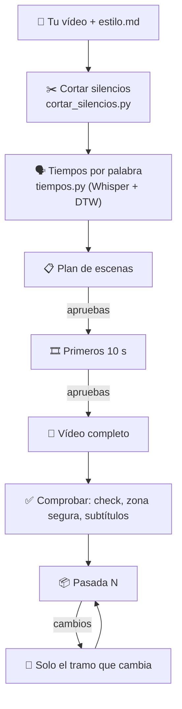

# Flujo de trabajo

De un reel que te gusta a tu vídeo listo para subir.

## Contenido
- [1. Sacar el estilo de un reel](#1-sacar-el-estilo-de-un-reel)
- [2. Editar tu vídeo con un estilo](#2-editar-tu-vídeo-con-un-estilo)
- [3. Variaciones y subida](#3-variaciones-y-subida)
- [Qué estilo usar](#qué-estilo-usar)

## 1. Sacar el estilo de un reel

Di a Claude: *«Copia el estilo de este reel: <link>»* (`/crear-videos-pro:crear-estilo-videos`).

1. Te pide un nombre para el estilo y crea `~/crear-videos/mis-estilos/<nombre>/`.
2. Baja el reel (yt-dlp; si falla, ScrapeCreators con tu clave).
3. Saca fotogramas (~15 por segundo), cortes, medidas de audio y la transcripción con Whisper en tu ordenador.
4. Te pregunta qué quieres replicar, si tiene música y qué sonidos.
5. Lee los mosaicos y mide subtítulos y encuadre.
6. Escribe `estilo.md`: reglas con valores medidos, receta para replicar y zonas seguras de Instagram.

## 2. Editar tu vídeo con un estilo

Di a Claude: *«Edita este vídeo con el estilo <nombre>»* (`/crear-videos-pro:editar-con-estilo`).

- Todo se guarda en `~/crear-videos/mis-videos/<vídeo>/`.
- El vídeo sale con el sonido tal cual lo renderiza HyperFrames: no se normaliza el volumen.
- Para un cambio pequeño (intro, un tramo, el sonido) se hace la operación mínima, sin volver a renderizar todo.

## 3. Variaciones y subida

- *«Hazme 5 variaciones»* (`/crear-videos-pro:variaciones-video`): 5 vídeos con ganchos, encuadres e inicios distintos y 5 descripciones.
- *«Adáptalos para subir»* (`/crear-videos-pro:adaptar-para-subir`) o *«Adapta estas fotos»* (`/crear-videos-pro:adaptar-fotos`).

## Qué estilo usar

| Vídeo | Estilo |
|---|---|
| YouTube horizontal, largo | `estilos/Estilo Maestria/youtube/` + `motores/motor-youtube/` |
| Lecciones del curso | `estilos/Estilo Maestria/formacion/` + `motores/motor-formacion/` |
| Vídeo para la comunidad de WhatsApp | `estilos/Estilo Maestria/whatsapp-comunidad/` |
| Reel vertical con motions de interfaz | `estilos/Estilo Maestria/edicion-claude/` (+ escenas g01–g12) |
| Copiar a otro creador | `estilos/creadores/<creador>/` o uno tuyo de `~/crear-videos/mis-estilos/` |

Las reglas generales aprendidas en vídeos reales están en la [§15 de la ficha de YouTube](../estilos/Estilo%20Maestria/youtube/estilo.md#15-reglas-aprendidas-en-vídeos-reales-valen-para-todo-el-estilo-maestria).
